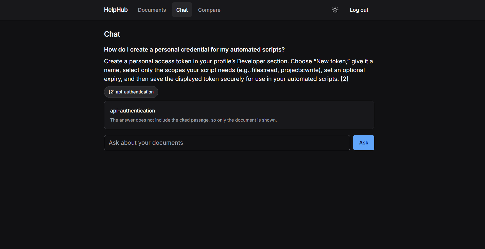
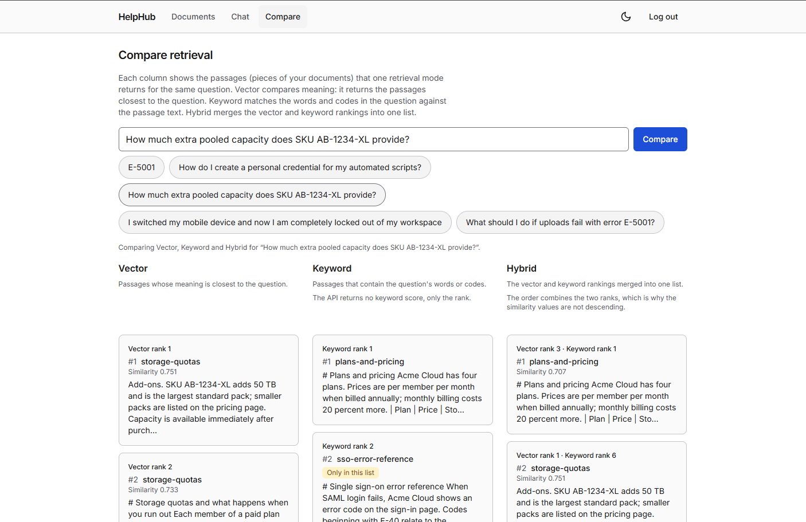
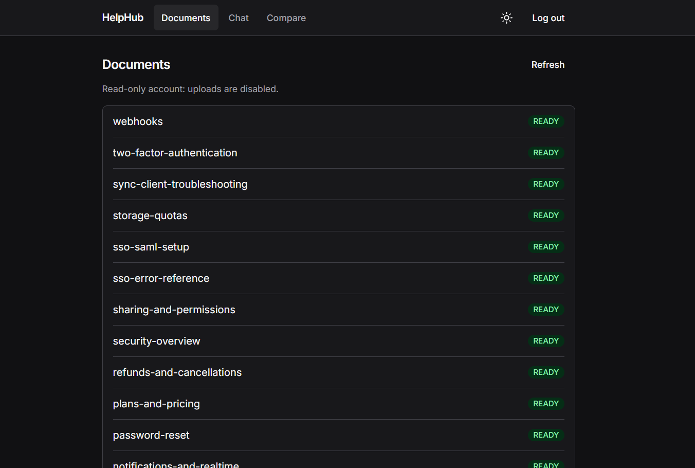
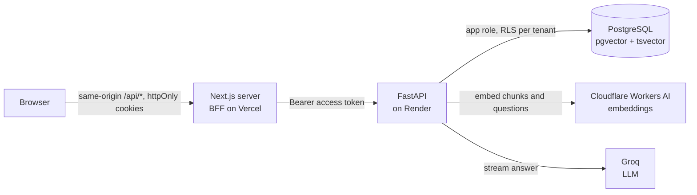

# HelpHub

A multi-tenant support knowledge engine: each company uploads its documents to an isolated workspace and asks questions that are answered from those documents, with citations.

[](https://github.com/Krishna-Keerthan/HelpHub/actions/workflows/ci.yml)
[](https://github.com/Krishna-Keerthan/HelpHub/actions/workflows/frontend.yml)

## Live demo

**<https://frontend-two-blush-lan0ovha4l.vercel.app>**

Open the login page and press **Try the demo**. It signs you in to a shared, read-only demo workspace; no account is needed. Sign-up is closed: new workspaces are created by the operator, not through the UI (`docs/deploy/runbook.md`, "Creating tenants").

Questions worth trying in Chat (the same five appear as buttons on the Compare page; they are chosen to show where keyword, vector and hybrid search differ):

1. `E-5001`
2. How do I create a personal credential for my automated scripts?
3. How much extra pooled capacity does SKU AB-1234-XL provide?
4. I switched my mobile device and now I am completely locked out of my workspace
5. What should I do if uploads fail with error E-5001?

The backend runs on a free hosting tier and sleeps after a period without traffic. The first request after idle can be slow while it wakes; the UI shows a "waking up" message instead of failing. Render documents the wake-up as about a minute ([`docs/frontend/decisions.md`](docs/frontend/decisions.md), D1); it has not been measured on this deployment.

## Screenshots








## What it does

- Accepts `.txt`, `.md` and `.pdf` uploads, splits them into chunks and embeds each chunk.
- Answers a question from the signed-in workspace's documents only, streaming the answer token by token and tagging claims with `[n]` citations that map to source documents.
- Refuses when nothing retrieved is relevant enough, instead of letting the model answer from general knowledge.
- Searches by vector, by keyword, or by both (hybrid), and a Compare page shows the three result lists side by side with the rank each passage had in each branch.
- Keeps a workspace per company with three roles (admin, agent, viewer). Only admins and agents see the upload control, and only admins see delete.
- Restores the open chat conversation after a page refresh, and marks an answer that was cut off.
- Light and dark themes.

## How it works



The browser never talks to FastAPI directly. The Next.js server holds the tokens in cookies and forwards requests with the access token as a Bearer header.

### Life of one chat question

`POST /chat/stream` ([`backend/app/services/chat.py`](backend/app/services/chat.py), contract in [`docs/api/chat-stream.md`](docs/api/chat-stream.md)):

1. The conversation is created or loaded, history is read and the question is saved, in one short transaction. An unknown conversation id is a 404 before any stream starts.
2. The question is embedded by the embedding provider with no database transaction open.
3. Retrieval runs in its own transaction: vector and keyword candidates for the tenant are ranked and fused by reciprocal rank fusion in one SQL statement ([`backend/app/db/repositories/chunks.py`](backend/app/db/repositories/chunks.py)).
4. Hits whose cosine similarity to the question is below `min_retrieval_score` are dropped. If none remain, the user gets a fixed refusal text (not model output) and the status `no_answer`.
5. Otherwise the prompt is built from the recent history and the numbered passages, and a `sources` event is sent first.
6. The LLM answer is streamed as `token` events with no transaction open.
7. A final `done` event carries the status and the sorted list of `[n]` numbers the answer actually cites; numbers that match no source are dropped. The assistant message is saved even if the client disconnected (status `interrupted`).

A failure after the stream has started arrives as an `error` event with a short code (`llm_unavailable`, `embedding_unavailable`, `internal_error` and others, listed in `docs/api/chat-stream.md`). The code is the whole message; no provider text is passed on.

### Tenancy and auth

- Every tenant-owned table has a `tenant_id`. The tenant comes from the verified JWT only, never from a request field.
- Each request or short transaction sets `app.tenant_id` as a transaction-local setting ([`backend/app/db/tenant_context.py`](backend/app/db/tenant_context.py)), and Row-Level Security policies on the tables compare `tenant_id` to it. The queries also filter by tenant, so RLS is a second layer.
- The runtime connects as a limited role (`helphub_app`). Migrations run as a separate owner role ([`docker/postgres/init/01-roles.sh`](docker/postgres/init/01-roles.sh), [`docs/review/accepted-risks.md`](docs/review/accepted-risks.md) AR-21).
- Access tokens last 15 minutes. Refresh tokens last 7 days, are single-use with rotation, and reuse of a spent token revokes its whole family (AR-08). Passwords are hashed with Argon2.
- Login is rate-limited per tenant and email, and globally (AR-07, AR-19).

## Engineering notes

1. **RLS with separate owner and app roles.** The runtime role is subject to RLS; only Alembic connects as the table owner, which bypasses it. The condition that keeps this true (the runtime service never receives the owner URL) is recorded, along with the fact that RLS is enabled but not forced. See AR-21 in [`docs/review/accepted-risks.md`](docs/review/accepted-risks.md) and the role setup in [`docs/deploy/runbook.md`](docs/deploy/runbook.md).
2. **Hybrid search by rank fusion, scores not merged.** Cosine similarity and the full-text rank (`ts_rank_cd`) are on different scales, so the two lists are fused by rank (`1/(60+rank)` summed over branches) and ordered by that. Each hit's `score` is its cosine to the query whichever branch found it, and only that cosine is thresholded; a keyword-only hit below the threshold is refused or left out (AR-11, [`chunks.py`](backend/app/db/repositories/chunks.py)). Keyword, vector and hybrid search were compared on a 32-question set ([`docs/demo/mode-summary.md`](docs/demo/mode-summary.md)). The evaluation of the relevance gate (the similarity threshold below which the assistant refuses) is being re-run; see AR-10 in [`docs/review/accepted-risks.md`](docs/review/accepted-risks.md).
3. **No transaction held across a slow call.** Embedding and LLM streaming run with no transaction open; the chat service uses several short tenant transactions instead. A client disconnect still saves the partial answer, using a shielded write in a `finally` block ([`chat.py`](backend/app/services/chat.py)).
4. **A BFF with httpOnly cookies and a single-flight refresh.** Tokens live in `SameSite=Lax` httpOnly cookies. Because a refresh token can be spent once, the client coordinates refreshes within a tab and across tabs (Web Locks) so parallel 401s cause one rotation, and the cookie is cleared only when the refresh call itself returns 401, not on timeouts or cold starts. The token `exp` is treated as a hint and never as authorization ([`docs/frontend/decisions.md`](docs/frontend/decisions.md) D1, D7, D8, D10). A known residual case (a refresh response lost in transit) is accepted as AR-F1 / D9.
5. **Write controls fail closed.** Upload and Delete render only after `/auth/me` returns a known role; while the lookup is pending, or when it fails or returns something unexpected, the page is read-only. The backend enforces roles regardless (D11, D13).
6. **SSE errors as codes, not messages.** Pre-stream problems are ordinary HTTP statuses; once the response is a 200 event stream, failures are an `error` event with a code the UI maps to its own wording. No status codes or backend text are shown ([`docs/api/chat-stream.md`](docs/api/chat-stream.md), D12).
7. **Restore after refresh without storing answers in the browser.** Only the conversation id and the last Compare query go to `sessionStorage`; on mount the chat history is re-read from the server, which is scoped by tenant and user. An answer cut off by navigation shows as cut off (D15).
8. **Token-based theming with a contrast check.** Each colour token is written once as `light-dark(light, dark)`, the chosen theme is a cookie read by the server layout so there is no flash, and `npm run contrast` checks the token pairs against WCAG 2.x ([`frontend/scripts/contrast.mjs`](frontend/scripts/contrast.mjs), D16). It runs in the Frontend workflow (`.github/workflows/frontend.yml`, line 44).
9. **A deterministic gate.** `scripts/gate.sh` runs the same checks locally and in CI, including grep rules that encode the architecture (no `get_session` outside two files, no `str(exc)` or `print` in `app/`) and an import-linter contract for layering. Exceptions need an inline `gate-allow` marker with a reason ([`scripts/gate.sh`](scripts/gate.sh), [`scripts/gate_checks.py`](scripts/gate_checks.py)).

## Tech stack

| Layer | Tool | Why |
|---|---|---|
| Frontend | Next.js 16, React 19, TypeScript, Tailwind CSS 4 | Server-side BFF routes keep tokens out of browser JavaScript (`frontend/package.json`) |
| Client data | TanStack Query (in-memory cache) | De-duplication and stale-while-revalidate for the documents list and role (D13) |
| API | FastAPI, Pydantic | Async routes and SSE streaming |
| ORM and migrations | SQLAlchemy 2 (async), Alembic | Typed async access; migrations run as the owner role |
| Database | PostgreSQL with pgvector (HNSW index) and `tsvector` | One engine for vector search, keyword search and RLS, so there is a single search path |
| Embeddings | Cloudflare Workers AI in production, fastembed locally | Small hosted model avoids loading one in the free-tier container (AR-20, runbook) |
| LLM | Groq API | Streamed completions; model is a setting (`groq_model`, `backend/app/core/config.py`) |
| Passwords and tokens | Argon2 (pwdlib), PyJWT | `backend/pyproject.toml` |
| PDF text | pypdf in a resource-limited child process | `backend/app/services/pdf_worker.py`, AR-01 |
| Tests | pytest, Vitest | Backend and frontend suites |
| Hosting | Vercel (frontend), Render (backend), Supabase (database) | Free tiers; see Deployment |
| Dev tooling | uv, ruff, import-linter, pip-audit, gitleaks | Run by the gate and CI |

## Run it locally

Prerequisites: Docker with Compose, [uv](https://docs.astral.sh/uv/) with Python 3.12 or newer (`backend/pyproject.toml`), Node 24 (`frontend/.nvmrc`), and a [Groq](https://console.groq.com/) API key for chat answers. Embeddings run locally with fastembed unless `EMBEDDING_PROVIDER=cloudflare`, which needs a Cloudflare account ID and a Workers AI API token from the [Cloudflare dashboard](https://dash.cloudflare.com/).

```bash
cp .env.example .env            # then fill in the values; comments in the file explain each
docker compose up -d --wait     # Postgres with pgvector on localhost:5432

cd backend
uv sync
uv run alembic upgrade head
uv run python scripts/seed_tenant.py --help   # creates a workspace and its first admin
uv run fastapi dev app/main.py                # API on :8000, docs at /docs

cd ../frontend
cp .env.example .env.local      # set BACKEND_URL to the running backend
npm ci
npm run dev                     # UI on :3000
```

Environment variable names in `.env.example`: `POSTGRES_USER`, `POSTGRES_PASSWORD`, `POSTGRES_DB`, `APP_DB_PASSWORD`, `DATABASE_URL`, `MIGRATION_DATABASE_URL`, `JWT_SECRET`, `JWT_ALGORITHM`, `ACCESS_TOKEN_MINUTES`, `GROQ_API_KEY`, `APP_ENV`, `CORS_ORIGINS`, `ALLOW_PUBLIC_REGISTRATION`. The frontend reads `BACKEND_URL` and `ALLOWED_ORIGINS`, plus `DEMO_EMAIL`, `DEMO_PASSWORD` and `DEMO_TENANT_SLUG` for the demo button ([`docs/frontend/deploy.md`](docs/frontend/deploy.md)).

Tests, from `backend/`:

```bash
uv run pytest                          # default run; slow tests are skipped
uv run pytest -m "slow or not slow"    # everything
uv run ruff check . && uv run ruff format .
```

Frontend, from `frontend/`: `npm run lint`, `npm run typecheck`, `npm test`, `npm run contrast`, `npm run build`.

The gate, from the repo root: `scripts/gate.sh` (add `--full` for the whole test suite). It refuses to run against a non-local database. Do not run two pytest sessions at once; they share a database and a lock file refuses the second.

## Testing and CI

On every pull request (`.github/workflows/ci.yml`, `.github/workflows/frontend.yml`):

- **CI / gate:** Postgres is started, roles and migrations are applied, then `scripts/gate.sh --full` runs.
- **CI / audit:** `scripts/audit_deps.sh full`.
- **CI / image:** builds the backend Docker image.
- **CI / secrets:** gitleaks over the full history.
- **Frontend:** a check that the generated API types are current, then `npm run lint`, `typecheck`, `test`, `build` and `contrast`. It runs when `frontend/`, `docs/api/` or the workflow changes.

What `scripts/gate.sh` checks, in order, stopping at the first failure:

1. A guard that the configured database is local.
2. Script file modes, and no untracked files in checked directories.
3. `ruff check`, `ruff format --check` on changed files, `import-linter`, `alembic check`.
4. Grep rules: no skip/xfail markers in tests, no planner flags, no `str(exc)` or `logger.exception`, no `print(` in `app/`.
5. `gate-allow` marker format, a secret scan, and the accepted-risk register format.
6. No use of `get_session` outside the files allowed to use it.
7. The security tests (`tests/security`).
8. `pip-audit` on production dependencies (blocking) and on the full environment (warning only).
9. With `--full`: the whole pytest suite including slow tests.

Tests live under `backend/tests/` by domain, with isolation tests (cross-tenant and RLS) in `tests/isolation/` and end-to-end acceptance tests in `tests/acceptance/` ([`backend/tests/README.md`](backend/tests/README.md)).

## Deployment

The frontend runs on Vercel, the backend on Render's free web service, and the database on Supabase's free tier, reached through its session pooler. A manual workflow (`.github/workflows/db-ops.yml`) provides `migrate` and `backup` jobs. Steps, role setup, environment names and the open items are in [`docs/deploy/runbook.md`](docs/deploy/runbook.md); the frontend side is in [`docs/frontend/deploy.md`](docs/frontend/deploy.md).

## Known limitations

- **Free-tier cold start.** The backend sleeps when idle and the first request after that is slow. The UI shows a waking-up state. No cold-start time has been measured on Render ([`docs/deploy/runbook.md`](docs/deploy/runbook.md), status block).
- **Render memory is unmeasured.** The only memory measurement with the production embedding provider was taken in local Docker with emulated limits and a stub LLM; it plateaued at about 165 MB (runbook, "Cloudflare-embedding plateau"). Nothing is recorded for the real instance.
- **Retrieval threshold is weak.** `min_retrieval_score` is 0.59 and cosine alone does not separate answerable from unanswerable questions in the evaluation done so far. That evaluation was marked an invalid measurement and a corrected re-run is pending (AR-10, AR-18, [`docs/eval/protocol.md`](docs/eval/protocol.md)). Expect some wrong answers on near-miss questions and some wrong refusals.
- **Embedding quota and data flow.** Every chunk and every question is sent to Cloudflare Workers AI. If the free daily allowance runs out, search, uploads and chat fail until it resets; quota behaviour was not exercised (AR-20).
- **Chat restore shows the first 200 messages** of a conversation; there is no paging yet. The Compare cache and the documents/role cache are per tab, so a stale tab can show an old role for up to five minutes (the backend still enforces roles) ([`docs/frontend/decisions.md`](docs/frontend/decisions.md) D13, D15).
- **Uploads are capped at 4 MiB in the browser** because of Vercel's 4.5 MB request limit; the backend itself allows 5 MiB (D5).
- **Rate limits are in-process** and reset on restart; they are not shared across instances (AR-13). The shared demo account shares one chat limit across all visitors, and a read-only role can still write chat messages in its own workspace (AR-22).
- **A lost refresh response can force a new login** (D9).
- **No escalation or hand-off** to a human; a refusal is the only fallback (D2).

The full list of accepted risks, each with an ID and a revisit condition, is [`docs/review/accepted-risks.md`](docs/review/accepted-risks.md).

## Author

Krishna Keerthan K, [github.com/Krishna-Keerthan](https://github.com/Krishna-Keerthan).

TODO(owner): add contact details and the demo video link.
