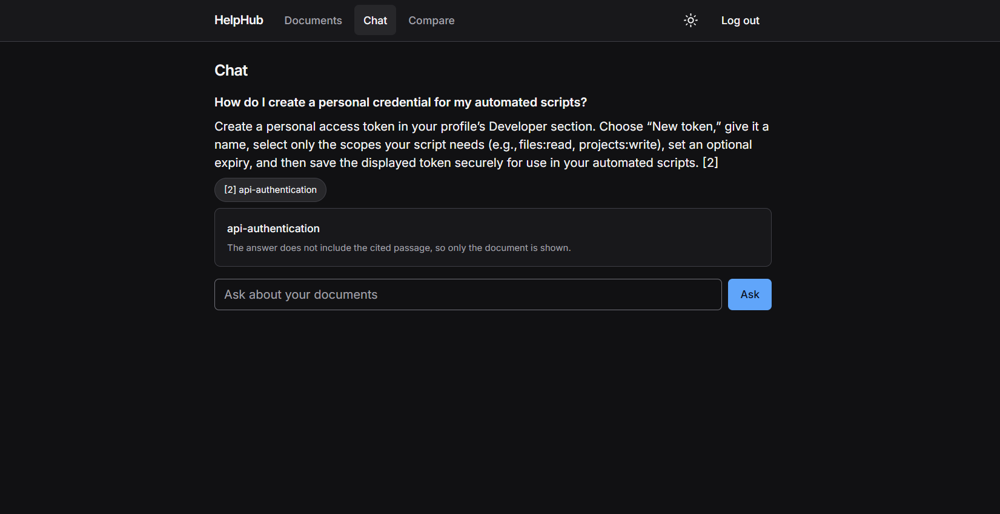
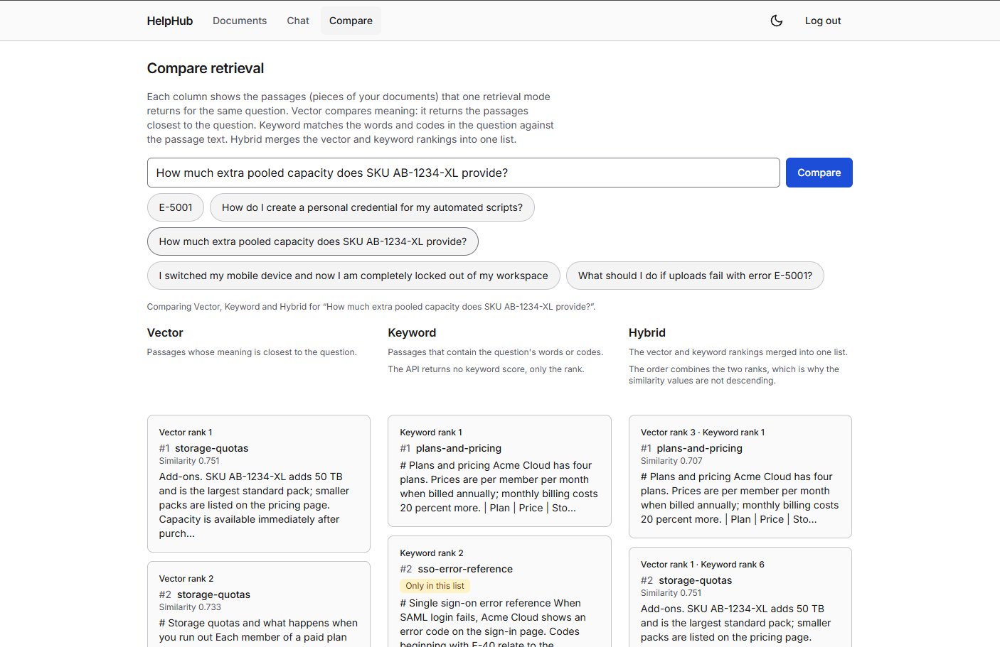
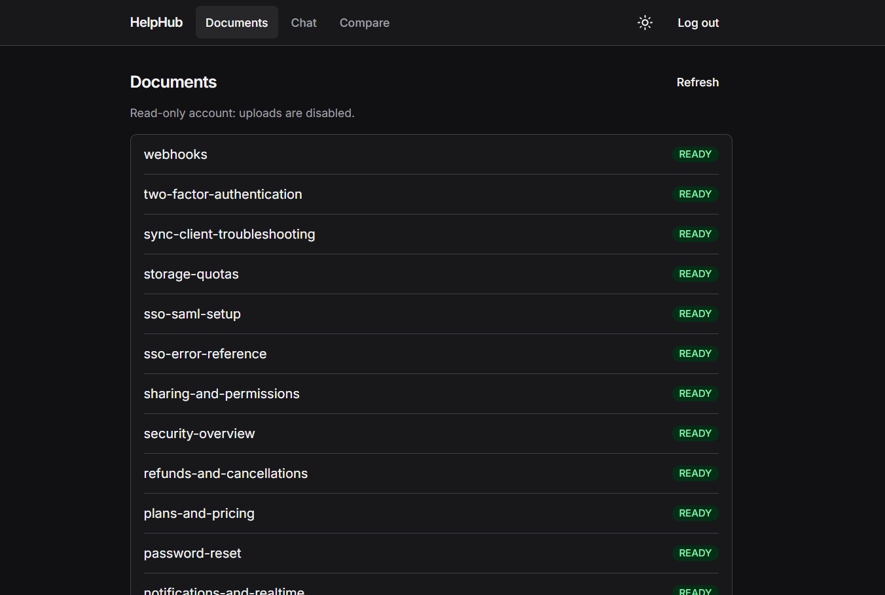
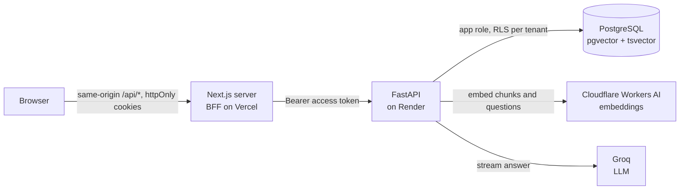

# HelpHub

A small multi-tenant question-answering app, built as a personal project. Each company uploads its documents to its own workspace and asks questions that are answered from those documents, with citations.

[](https://github.com/Krishna-Keerthan/HelpHub/actions/workflows/ci.yml)
[](https://github.com/Krishna-Keerthan/HelpHub/actions/workflows/frontend.yml)

## Live demo

**<https://frontend-two-blush-lan0ovha4l.vercel.app>**

Open the login page and press **Try the demo**. It signs you in to a shared, read-only demo workspace; no account is needed. This is a closed beta: sign-up is closed, and the operator creates new workspaces (see the runbook, `docs/deploy/runbook.md`, "Creating tenants").

The backend runs on a free tier and sleeps when idle, so the first request after a pause can be slow. The UI shows a "waking up" message instead of failing. Render documents the wake-up as about a minute ([`docs/frontend/decisions.md`](docs/frontend/decisions.md)); it has not been measured on this deployment.

Questions worth trying in Chat (the same five appear as buttons on the Compare page; they show where keyword, vector and hybrid search differ):

1. `E-5001`
2. How do I create a personal credential for my automated scripts?
3. How much extra pooled capacity does SKU AB-1234-XL provide?
4. I switched my mobile device and now I am completely locked out of my workspace
5. What should I do if uploads fail with error E-5001?

## Screenshots







## What it does

- Accepts `.txt`, `.md` and `.pdf` uploads, splits them into chunks and embeds each chunk.
- Answers a question from the signed-in workspace's documents only. The answer streams in and carries `[n]` citations that point to the source documents.
- Refuses when nothing retrieved is relevant enough, instead of answering from general knowledge.
- Searches by vector, by keyword, or both (hybrid). A Compare page shows the three result lists side by side.
- Has three roles per workspace: admin, agent and viewer. Admins and agents can upload; only admins can delete.
- Restores the open conversation after a page refresh.
- Light and dark themes.

## How it works



The browser never talks to FastAPI directly. The Next.js server keeps the tokens in cookies and forwards requests with the access token as a Bearer header.

A chat question (`POST /chat/stream`, see [`docs/api/chat-stream.md`](docs/api/chat-stream.md)) goes through these steps:

1. The question is saved and the recent history is loaded.
2. The question is embedded.
3. Vector and keyword matches for the workspace are ranked and merged with reciprocal rank fusion, in one SQL statement.
4. Passages below a similarity cut-off (`min_retrieval_score`, 0.59) are dropped. If none are left, the user gets a fixed "no answer" reply.
5. Otherwise the sources are sent first, then the model's answer streams in token by token.
6. A final event lists which `[n]` citations the answer actually used.

### Design notes

- **Tenant isolation.** The tenant comes from the signed login token, never from a request field. Postgres row-level security is a second layer, and the app connects as a limited database role.
- **Login.** Access tokens last 15 minutes. Refresh tokens last 7 days, are single-use, and reusing a spent one revokes the whole session family. Passwords use Argon2, and login is rate-limited.
- **No open transaction during slow calls.** Embedding and the LLM stream run with no database transaction held.
- **Write controls fail closed.** Upload and Delete appear only after the user's role is known. The backend checks roles anyway.
- **Errors as codes.** Failures during a chat stream arrive as a short code that the UI turns into its own wording; provider text is never shown.

## Tech stack

| Layer | Tool |
|---|---|
| Frontend | Next.js 16, React 19, TypeScript, Tailwind CSS 4, TanStack Query |
| API | FastAPI, Pydantic, SQLAlchemy 2 (async), Alembic |
| Database | PostgreSQL with pgvector and `tsvector` |
| Embeddings | Cloudflare Workers AI in production, fastembed locally |
| LLM | Groq API |
| Auth | Argon2 (pwdlib), PyJWT |
| PDF text | pypdf in a resource-limited child process |
| Tests | pytest, Vitest |
| Hosting | Vercel (frontend), Render (backend), Supabase (database), all on free tiers |
| Tooling | uv, ruff, import-linter, pip-audit, gitleaks |

## Run it locally

Prerequisites: Docker with Compose, [uv](https://docs.astral.sh/uv/) with Python 3.12 or newer, Node 24 (`frontend/.nvmrc`), and a [Groq](https://console.groq.com/) API key for chat answers. Embeddings run locally with fastembed unless `EMBEDDING_PROVIDER=cloudflare`, which needs a Cloudflare account ID and a Workers AI API token.

```bash
cp .env.example .env            # then fill in the values; comments in the file explain each
docker compose up -d --wait     # Postgres with pgvector on localhost:5432

cd backend
uv sync
uv run alembic upgrade head
uv run python scripts/seed_tenant.py --help   # creates a workspace and its first admin
uv run fastapi dev app/main.py                # API on :8000, docs at /docs

cd ../frontend
cp .env.example .env.local      # set BACKEND_URL to the running backend
npm ci
npm run dev                     # UI on :3000
```

The variable names are listed in `.env.example` and `frontend/.env.example`; the demo button also needs `DEMO_EMAIL`, `DEMO_PASSWORD` and `DEMO_TENANT_SLUG` ([`docs/frontend/deploy.md`](docs/frontend/deploy.md)).

Tests, from `backend/`: `uv run pytest` (slow tests are skipped; `-m "slow or not slow"` runs everything). Frontend, from `frontend/`: `npm run lint`, `npm run typecheck`, `npm test`, `npm run build`. From the repo root, `scripts/gate.sh` runs the lint, layering, secret and security checks (add `--full` for the whole test suite). It refuses to run against a non-local database.

## Testing and CI

GitHub Actions runs on every pull request and push to main: the gate with the full test suite, a dependency audit, a Docker image build, a gitleaks secret scan, and, when frontend files change, lint, typecheck, tests, build and a colour-contrast check.

Tests live under `backend/tests/` by domain; cross-tenant tests are in `tests/isolation/`. This is a closed beta website.

A concurrent isolation stress run (10 tenants, reads and writes, local database) is described in [`backend/tests/README.md`](backend/tests/README.md#isolation-stress-run-2026-11-01).

Covered: tenant isolation, login and token refresh, rate limits, role checks, the Groq and Cloudflare clients, the relevance cut-off and refusal, upload and ingestion, search, migrations and the OpenAPI contract. On the frontend: the BFF passthrough, cookies and origin checks, session refresh, the stream and citation parsers, safe Markdown, role-gated controls, and chat and Compare restore.

Not covered: UI layout, copy text, animation timing, most of the home page and the helper scripts. Those are checked by hand and with `scripts/smoke_live.py` against the live service.

## Deployment

The frontend runs on Vercel, the backend on Render's free web service, and the database on Supabase's free tier. A manual workflow (`.github/workflows/db-ops.yml`) provides `migrate` and `backup` jobs, but no backups exist: the `backup` job cannot run while the repository is public. Steps and environment names are in [`docs/deploy/runbook.md`](docs/deploy/runbook.md); the frontend side is in [`docs/frontend/deploy.md`](docs/frontend/deploy.md).

## Known limitations

- **Cold start.** The backend sleeps when idle and the first request after that is slow. The wake-up time has not been measured.
- **The relevance cut-off is weak.** On one small corpus (32 answerable and 31 unanswerable questions), the 0.59 cut-off refused all 16 off-topic questions and 2 of the 32 answerable ones, but passed 13 of 15 near-miss questions to the model. Expect some wrong answers on questions close to the documents, and some wrong refusals. Details: [accepted risks](docs/review/accepted-risks.md).
- **Embedding quota.** Every chunk and question goes to Cloudflare Workers AI. If the free daily allowance runs out, search, uploads and chat fail until it resets.
- **Upload size.** The browser caps uploads at 4 MiB because of Vercel's request limit; the backend allows 5 MiB, and extracted text is capped at 500,000 characters.
- **Rate limits are in-process,** so they reset on restart. The shared demo account shares one chat limit across all visitors.
- **Chat restore** shows the first 200 messages of a conversation. A stale tab can show an old role for up to five minutes; the backend still enforces roles.
- **No human hand-off.** A refusal is the only fallback.

The longer list of accepted risks is in [`docs/review/accepted-risks.md`](docs/review/accepted-risks.md).

## Author

Krishna Keerthan K, [github.com/Krishna-Keerthan](https://github.com/Krishna-Keerthan).
